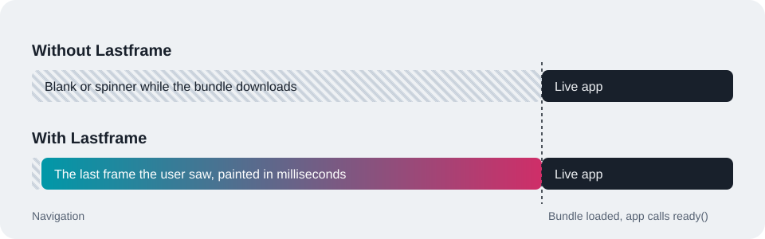

<p align="center">
  
</p>

<p align="center">
  <b>Your app's last frame, painted before your JavaScript arrives.</b><br />
  Instant revisits for client-rendered apps. No SSR, no framework migration.
</p>

<p align="center">
  <a href="https://www.npmjs.com/package/lastframe"></a>
  <a href="https://scorecard.dev/viewer/?uri=github.com/joseph0926/lastframe"></a>
  <a href="./LICENSE"></a>
</p>

<p align="center">
  <a href="https://joseph0926.github.io/lastframe/"><b>Live demo</b></a> (reload the page to see it work)
  &nbsp;|&nbsp; <a href="./docs/README.ko.md">한국어</a>
</p>

---

A client-rendered app shows nothing useful until its bundle has downloaded, parsed, and rendered. On a phone or a slow network that is seconds of blank screen, on every visit, even for an app the user opens twenty times a day.

Lastframe remembers what each page looked like when the user left and paints it again on the next visit, before your bundle has even arrived. When your app is ready, the frame cross-fades into the live UI.

<p align="center">
  
</p>

- **Framework-agnostic core** with a drop-in React `createRoot`, and a one-line `ready()` for Vue, Svelte, Solid, or plain DOM
- **Tiny boot path**: a self-contained script of about 4 KB gzipped reads one IndexedDB record and paints
- **Safe by construction**: the frame is an inert, sanitized overlay outside your app's container, so your app renders into an untouched element and nothing in the frame can be clicked
- **Privacy controls**: mask content into a skeleton before it is stored, exclude elements, scope frames per user, and clear them on sign-out
- **Vite 7 and 8** plugin, plus a bundler-agnostic build helper

## Install

```bash
npm install lastframe
```

## Quick start (Vite + React)

**1. List the routes worth replaying.** Nothing is captured until you do.

```ts
// vite.config.ts
import react from '@vitejs/plugin-react';
import { lastframe } from 'lastframe/vite';
import { defineConfig } from 'vite';

export default defineConfig({
  plugins: [react(), lastframe({ routes: ['/', '/inbox', '/projects/:id'] })],
});
```

**2. Swap one import.**

```tsx
// main.tsx
import { createRoot } from 'lastframe/react'; // instead of 'react-dom/client'

createRoot(document.getElementById('root')!).render(<App />);
```

That's it. The first visit records a frame; every revisit opens on it.

### Wait for real content

If your first render is a loading state, removing the frame on the first commit would show the user a spinner after they already saw their content. Hold the frame until the data is on screen:

```tsx
import { createRoot, useFrameReady } from 'lastframe/react';

createRoot(container, { waitForReady: true }).render(<App />);

function Inbox() {
  const { data } = useQuery(inboxQuery);
  useFrameReady(data !== undefined);
  // ...
}
```

The ready condition should be "my local or cached data is rendered", not "the server answered". The policy's `timeout` (10 s by default) removes the frame even if `ready` never comes.

### Other frameworks

The core works with anything that renders into an element. Call `ready()` once your UI is on screen:

```ts
import { ready } from 'lastframe';

createApp(App).mount('#root'); // Vue
ready();
```

```ts
mount(App, { target: document.getElementById('root')! }); // Svelte
ready();
```

If your app does not render into `#root`, set `root` in the plugin options, or pass the element: `ready({ root: element })`.

### Other bundlers

`lastframe/build` returns the boot script for a policy. Put it in a classic `<script>` at the top of `<head>`, before your bundle:

```ts
import { renderBootScript } from 'lastframe/build';

const code = await renderBootScript({ routes: ['/', '/inbox'] });
html = html.replace('<head>', () => `<head><script>${code}</script>`);
```

## How it works

1. **Capture.** After `ready()`, Lastframe serializes your app root, the CSS that styles it, and the look of `<html>` and `<body>`, once while the page is idle and again whenever it is hidden or closed. Frames are stored in IndexedDB, keyed by route.
2. **Paint.** On the next visit, the boot script runs before your bundle, reads the frame for the current route, sanitizes it, and paints it in a fixed overlay inside a shadow root. Your app's container is never touched.
3. **Hand off.** Your app renders underneath. `ready()` removes the overlay in the same frame the live UI appears, with a View Transition cross-fade where supported. Captured CSS keeps working inside the shadow root because selectors for `:root`, `html`, and `body` are rewritten to target stand-in elements.

## Options

All options go to the Vite plugin (or `renderBootScript`). They are validated at build time, so a typo fails the build instead of silently disabling Lastframe.

| Option      | Default   | Description                                                                                                       |
| ----------- | --------- | ----------------------------------------------------------------------------------------------------------------- |
| `routes`    | required  | Pathnames to capture and restore. `:param` matches one segment, a trailing `*` matches the rest. Exact paths win. |
| `mask`      | `false`   | `true` stores the whole page as a skeleton; a selector list masks only matching elements.                         |
| `exclude`   | `[]`      | Selectors removed from every frame: toasts, open modals, chat widgets.                                            |
| `version`   | none      | Frames captured under another version are discarded. Set it to your release id to drop frames after a deploy.     |
| `ttl`       | 7 days    | Maximum age of a frame, in milliseconds.                                                                          |
| `timeout`   | 10 000    | The frame is removed this many milliseconds after it was painted, even without `ready()`.                         |
| `maxBytes`  | 1 MiB     | Frames larger than this are not stored.                                                                           |
| `maxFrames` | 50        | Only the newest frames are kept.                                                                                  |
| `styles`    | `true`    | Store CSS with the frame. Turn off if your stylesheets can contain user data.                                     |
| `root`      | `'#root'` | The element your app renders into.                                                                                |
| `inline`    | `false`   | Vite only. Inline the boot script instead of emitting a hashed file. Needs a CSP hash or `nonce`.                 |
| `nonce`     | none      | Vite only. CSP nonce for the script tag.                                                                          |
| `debug`     | dev only  | Vite only. Log `[lastframe]` messages to the console.                                                             |

Routes can override the mask:

```ts
lastframe({
  routes: ['/', { path: '/billing', mask: true }, { path: '/inbox', mask: ['.message-body'] }],
});
```

## Privacy and safety

A frame is a copy of what was on screen. Decide what is allowed to be copied.

```tsx
<span data-lastframe-mask>{user.email}</span>      {/* stored as a skeleton block */}
<Toast data-lastframe-exclude />                   {/* never stored */}
```

- **Mask** with `data-lastframe-mask` or the `mask` option. Masking happens before the frame is written, so the real text and images never reach IndexedDB. Password field values are never stored.
- **Scope frames to the user** so a shared computer never shows the previous user's screen. Frames are only replayed for the scope that captured them.

  ```ts
  import { clearFrames, setScope } from 'lastframe';

  setScope(hash(user.id)); // after sign-in; use an opaque value
  // on sign-out:
  setScope(null);
  await clearFrames();
  ```

- **Version frames** with `version` so a deploy never replays an old UI.
- The overlay is sanitized on restore: scripts, frames, event handlers, links, form targets, and executable URLs are removed. It is marked `inert` and `aria-hidden`, and it swallows pointer events.
- IndexedDB is not encrypted. Treat frames like anything else in same-origin storage.
- Frames are a cache. When several tabs show the same route, the tab that captures last wins, and a failed write only means the next visit starts cold.

## API

### `lastframe` (core)

| Export                | Description                                                                                    |
| --------------------- | ---------------------------------------------------------------------------------------------- |
| `ready(options?)`     | The live UI is on screen: remove the frame and start capturing. Options: `transition`, `root`. |
| `capture()`           | Capture the current page now, for example before `location.assign()`.                          |
| `onCapture(listener)` | Subscribe to captured frames. Returns an unsubscribe function.                                 |
| `setScope(scope)`     | Tie frames to an identity. `null` clears it.                                                   |
| `clearFrames()`       | Delete every stored frame.                                                                     |
| `stopCapture()`       | Stop automatic capture for this page load.                                                     |
| `getRestoredFrame()`  | `{ route, capturedAt, paintedAt }` of the frame painted on this load, or `null`.               |
| `getStatus()`         | `'pending' \| 'restoring' \| 'restored' \| 'live'`.                                            |

### `lastframe/react`

| Export                          | Description                                                                         |
| ------------------------------- | ----------------------------------------------------------------------------------- |
| `createRoot(container, opts?)`  | Drop-in for `react-dom/client`. Extra options: `transition`, `waitForReady`.        |
| `useFrameReady(isReady = true)` | Mark the UI ready when `isReady` turns true. Only needed with `waitForReady: true`. |

### Styling hooks

- `html[data-lastframe="restored"]` is set while a frame is painted. Use it to hide your own HTML loading indicator.
- Inside the frame, the stand-in root carries `data-lastframe-frame`. Your CSS is captured with the frame, so `[data-lastframe-frame] .live-badge { display: none }` styles only the frame. The demo uses this to draw an afterimage on the headline while the frame is showing.

## When to use it

| Good fit                                                      | Reach for something else                                    |
| ------------------------------------------------------------- | ----------------------------------------------------------- |
| Dashboards, admin panels, CRMs, and tools people reopen daily | First visits and SEO: server rendering or static generation |
| Client-rendered apps where SSR is not an option               | Screens that must never show stale data, even briefly       |
| Slow devices and networks                                     | Pages that are rarely revisited                             |

Compared with alternatives: a build-time skeleton has no real content, a service worker app shell has no per-user state, and bfcache only covers back and forward navigation. Lastframe shows the actual last screen, which is why it comes with masking and scoping.

## Browser support

Any browser with IndexedDB, Shadow DOM, and `inert` (Chrome and Edge 102+, Firefox 112+, Safari 15.5+). The cross-fade uses the View Transitions API where available and falls back to an instant swap; it is skipped for users who prefer reduced motion.

## Debugging

Run the dev server and watch the console:

```
[lastframe] Painted /inbox (captured 41250 ms ago)
[lastframe] Live after 1840 ms on the frame
[lastframe] Captured /inbox (18.2 KiB)
```

Set `debug: true` in the plugin to keep these logs in a production build.

## Coming from FirstTx

Lastframe is the successor of `@firsttx/prepaint`. See the [migration guide](./docs/migration.md).

## Contributing

Issues and pull requests are welcome. See [CONTRIBUTING.md](./CONTRIBUTING.md). Run the demo locally with `pnpm demo`.

## License

MIT © [joseph0926](https://github.com/joseph0926)
